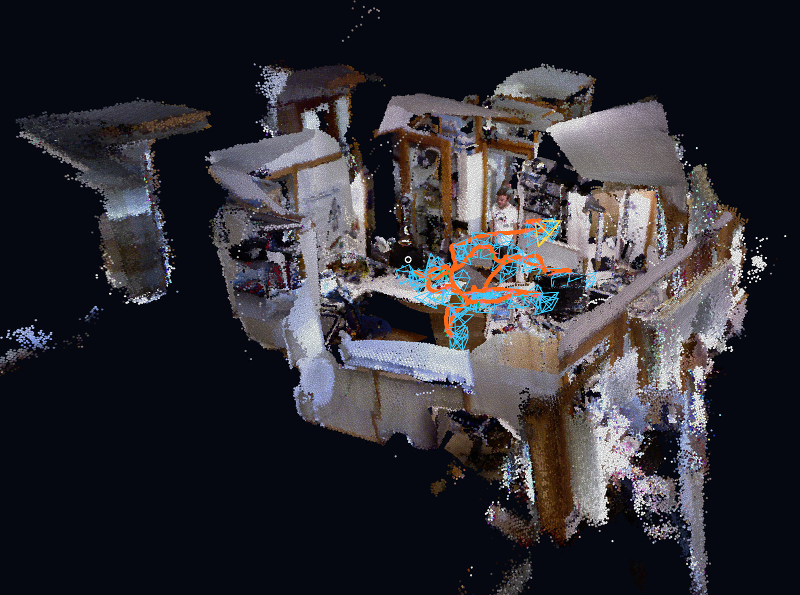
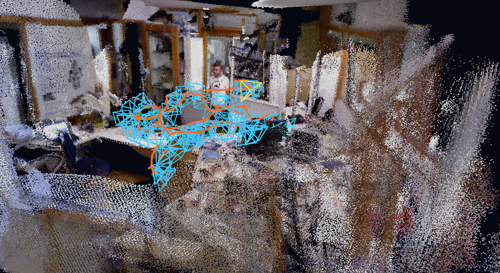

# SceneSLAM

CPU-first C++20 RGB-D visual odometry and bounded coloured point-cloud mapping.

**Current status:** RGB-D odometry & mapping; SLAM features are in progress. Loop closure and pose-graph optimisation are not implemented.



The whole of TUM RGB-D `freiburg1_room` — 1359 frames of real Kinect data, tracked end to end on the CPU with no GPU anywhere in the pipeline, with the estimated camera path in orange. The map is 1.4 M coloured voxel points; walls look thickened at the far corners because pure odometry drifts without loop closure.



The same reconstruction from inside the room, with every twentieth estimated pose drawn as a camera frustum. Both images are Rerun renderings of this pipeline's own output; nothing is hand-modelled or retouched.

| TUM RGB-D `freiburg1_room`, 1359 frames | Result |
| --- | --- |
| Tracked / lost frames | 1359 / 0 |
| ATE RMSE (SE(3)-aligned) | 0.412 m |
| RPE over 1 s | 0.070 m, 3.34° RMSE |
| Median tracking time | 29.9 ms per frame |
| Peak working set | 169 MB |

Measured on an i7-11800H with OpenCV 4.14; the absolute error is accumulated drift, and relative error per second is unchanged between the first 8 seconds and the full 45. See [the full record](docs/results_tum_fr1_room.md) for the commands, environment, and the trajectory plotted against ground truth.

## Features

- TUM RGB-D list parsing with nearest-timestamp association.
- ORB matching and metric 3D-to-2D PnP-RANSAC tracking.
- Explicit camera-to-world pose convention and `LOST` frames.
- Bounded voxel map exported as coloured ASCII PLY.
- TUM trajectory, JSONL frame diagnostics, summary JSON, and debug images.
- Deterministic geometry, association, PnP, output, pipeline, and CLI tests.

## Build

Requirements: CMake 3.20+, a C++20 compiler, and OpenCV 4.x with `core`, `calib3d`, `features2d`, `imgcodecs`, and `imgproc`.

```bash
cmake -S . -B build -DCMAKE_BUILD_TYPE=Release -DOpenCV_DIR=/path/to/opencv/lib/cmake/opencv4
cmake --build build --config Release
ctest --test-dir build -C Release --output-on-failure
```

On Windows with the official OpenCV archive, `OpenCV_DIR` is normally its `build` directory. Ensure the matching OpenCV DLL directory is in `PATH` when running the executable directly.

## Run

No dataset is downloaded automatically. Supply an extracted TUM RGB-D sequence:

```bash
scene_slam selftest
scene_slam run --dataset /path/to/rgbd_dataset_freiburg1_xyz \
  --camera configs/tum_freiburg1.yaml --out out/fr1_xyz --max-frames 250
```

`--voxel-size` and `--max-points` size the map. The defaults (3 cm, 500 000 points) stop accepting new voxels partway through a room-sized sequence; `summary.json` reports `map_capacity_reached` so a truncated map is never silent. The images above use `--voxel-size 0.02 --max-points 4000000`.

Outputs are `trajectory_tum.txt`, `frames.jsonl`, `map.ply`, `summary.json`, and `debug/*.png`. Open `map.ply` in CloudCompare or inspect the whole run in Rerun.

## Interactive 3D viewer

Create the viewer environment with `uv` and open a real run:

```bash
uv sync
uv run python scripts/view_map.py out/fr1_xyz
```

Rerun provides a persistent orientation gizmo, an entity tree for toggling the map, trajectory, and camera frusta, and a timeline for scrubbing the active camera pose. To preview the interface without a dataset, use an explicitly synthetic scene:

```bash
uv run python scripts/view_map.py --demo
uv run python scripts/view_map.py out/fr1_xyz --save out/fr1_xyz/recording.rrd
```

Open a saved recording later with `uv run rerun out/fr1_xyz/recording.rrd`. For reproducible screenshots, `--hide-panels`, `--hide-grid`, and `--eye/--look-at/--up` fix the composition, and the Rerun CLI renders it headlessly:

```bash
uv run python scripts/view_map.py out/fr1_xyz --save out/fr1_xyz/recording.rrd \
  --hide-panels --hide-grid --eye=5.1,-7.1,1.2 --look-at=0.3,0.0,0.9 --up=0,-1,0
uv run rerun out/fr1_xyz/recording.rrd --screenshot-to out/fr1_xyz/overview.png \
  --window-size 1600x1000
```

The world frame is the first camera frame, so `--up` is the scene's vertical expressed in that frame, not a fixed axis.

## Evaluation

Install `evo` separately (`uvx --from evo evo_ape ...` works without installing it), then print or execute metric-scale commands. The printed RPE windows default to 30 frames, one second at the TUM 30 Hz rate:

```bash
python scripts/evaluate.py --groundtruth /path/to/groundtruth.txt \
  --trajectory out/fr1_xyz/trajectory_tum.txt
python scripts/evaluate.py --groundtruth /path/to/groundtruth.txt \
  --trajectory out/fr1_xyz/trajectory_tum.txt --execute
python scripts/render_trajectory.py out/fr1_xyz/trajectory_tum.txt \
  --out out/fr1_xyz/trajectory_topdown.png
```

This repository contains no dataset files. The one measured run it does claim is recorded in full in [results on TUM fr1/room](docs/results_tum_fr1_room.md); no result is claimed for any other sequence. See [benchmark protocol](docs/benchmark_protocol.md) and [known limitations](docs/known_limitations.md).

## Coordinate convention

`T_world_from_camera` maps camera-frame points into world coordinates. PnP estimates `T_current_from_reference`; poses compose as `T_world_from_current = T_world_from_reference * inverse(T_current_from_reference)`. TUM export is `timestamp tx ty tz qx qy qz qw`.

## Third-party components

SceneSLAM implements its pipeline directly and uses OpenCV for image I/O, ORB, matching, PnP, and matrix operations. `evo` and Matplotlib are optional evaluation tools and are not runtime dependencies.

## Licence

MIT for the code. The images in `docs/images/` are renderings of SceneSLAM output computed from `rgbd_dataset_freiburg1_room` of the TUM RGB-D SLAM Dataset and Benchmark, which is licensed under Creative Commons Attribution 4.0; cite Sturm et al., IROS 2012 and follow the dataset licence when using TUM data.

