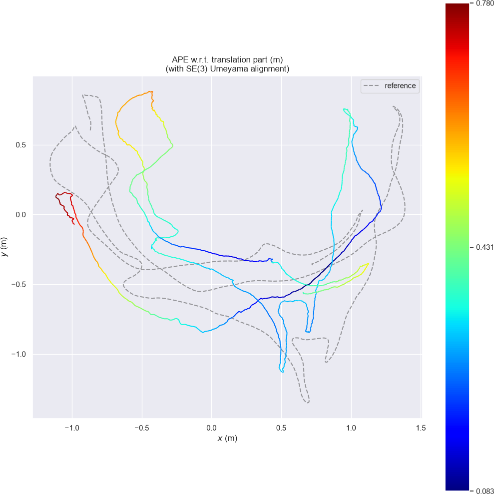

# Measured run: TUM RGB-D `freiburg1_room`

A complete record of the run shown in the README images, following
[the benchmark protocol](benchmark_protocol.md). Every number here comes from the
run described below; nothing is copied from another system or paper.

## Sequence

| Item | Value |
| --- | --- |
| Sequence | `rgbd_dataset_freiburg1_room` (unmodified) |
| Source | TUM RGB-D SLAM Dataset and Benchmark, Freiburg 1 |
| Length | 45.37 s of RGB timestamps, 1362 RGB and 1360 depth frames |
| Camera config | `configs/tum_freiburg1.yaml` (Freiburg 1 intrinsics, 5000 depth units per metre) |
| Ground truth | `groundtruth.txt` shipped with the sequence (motion capture) |

The dataset is not part of this repository and is not downloaded automatically.

## Environment

| Item | Value |
| --- | --- |
| OS | Windows 11 (26300) |
| CPU | Intel Core i7-11800H, 32 GB RAM |
| Compiler | MSVC 14.44.35207 (Visual Studio 2022), Release |
| OpenCV | 4.14.0 |
| Commit | `f52b77b` plus the CLI and viewer changes in this commit |

## Commands

```bash
scene_slam run --dataset data/rgbd_dataset_freiburg1_room \
  --camera configs/tum_freiburg1.yaml --out out/fr1_room_map \
  --voxel-size 0.02 --max-points 4000000

uvx --from evo evo_ape tum data/rgbd_dataset_freiburg1_room/groundtruth.txt \
  out/fr1_room_map/trajectory_tum.txt --align
uvx --from evo evo_rpe tum data/rgbd_dataset_freiburg1_room/groundtruth.txt \
  out/fr1_room_map/trajectory_tum.txt --align --delta 30 --delta_unit f
uvx --from evo evo_rpe tum data/rgbd_dataset_freiburg1_room/groundtruth.txt \
  out/fr1_room_map/trajectory_tum.txt --align --delta 30 --delta_unit f \
  --pose_relation angle_deg
```

`--delta 30 --delta_unit f` is one second of drift at the sequence's 30 Hz rate.
Alignment is rigid SE(3) only; scale is never corrected, because RGB-D output is
already metric.

## Tracking and runtime

| Metric | Full sequence | First 250 frames |
| --- | --- | --- |
| Paired frames | 1359 | 250 |
| Tracked / lost | 1359 / 0 | 250 / 0 |
| Tracking success | 100 % | 100 % |
| Median tracking time | 29.9 ms | 27.5 ms |
| p95 tracking time | 34.8 ms | 31.1 ms |
| Mean throughput | 33.4 FPS | 36.2 FPS |
| Map points | 1 421 956 (2 cm voxels) | 123 098 (3 cm voxels, default) |
| Peak working set | 169 MB | not measured |

Three RGB frames had no depth frame within the 20 ms association window and were
skipped; one depth frame stayed unmatched. Throughput varied between 32.7 and
36.2 FPS across repeated runs on the same machine; the trajectory output was
bit-identical every time, and the 250-frame run is a bit-identical prefix of the
full run.

## Accuracy against ground truth

Absolute pose error, translation part, SE(3)-aligned:

| Statistic | Full sequence | First 250 frames |
| --- | --- | --- |
| RMSE | 0.412 m | 0.083 m |
| Mean | 0.380 m | 0.080 m |
| Median | 0.348 m | 0.089 m |
| Max | 0.780 m | 0.131 m |
| Std | 0.157 m | 0.023 m |

Relative pose error over one-second windows (30 frames), SE(3)-aligned:

| Statistic | Translation (full) | Rotation (full) | Translation (250) | Rotation (250) |
| --- | --- | --- | --- | --- |
| RMSE | 0.070 m | 3.34° | 0.073 m | 3.76° |
| Mean | 0.060 m | 2.93° | 0.066 m | 3.40° |
| Max | 0.167 m | 7.46° | 0.110 m | 6.21° |

## Reading the numbers

Relative error per second is essentially the same over the first 8 seconds and
over the full 45, while absolute error grows by a factor of five. That is the
expected signature of pure odometry: local motion estimates stay consistent,
and their small errors integrate into unbounded global drift. The room is
revisited several times in this sequence, which is the condition under which
loop closure and pose-graph optimisation bound the absolute error.

The same drift is visible in the map: surfaces seen early and late in the
sequence are reconstructed at slightly different places, which thickens walls
and smears the far corners of the room.



Estimated trajectory coloured by absolute pose error, against the motion-capture
reference (grey dashed), top-down.

## Rendering the images

```bash
uv run python scripts/view_map.py out/fr1_room_map \
  --save out/fr1_room_map/recording.rrd --frustum-step 25 \
  --hide-panels --hide-grid \
  --eye=5.114,-7.142,1.236 --look-at=0.33,0.0,0.9 --up=-0.0327,-0.7529,-0.6573
uv run rerun out/fr1_room_map/recording.rrd --hide-welcome-screen \
  --screenshot-to out/fr1_room_map/overview.png --window-size 1600x1000
```

The close-up uses `--eye=3.085,-3.586,1.524 --frustum-step 20` with the same
target and up vector. The world frame is the first camera frame, so the up
vector above is the ground-truth vertical expressed in that frame; the published
images are cropped to the 3D view and downscaled, and are otherwise unedited.

## Attribution

Sequence `rgbd_dataset_freiburg1_room` from the TUM RGB-D SLAM Dataset and
Benchmark, licensed under Creative Commons Attribution 4.0. The screenshots in
this repository are renderings of SceneSLAM output computed from that data.

> J. Sturm, N. Engelhard, F. Endres, W. Burgard and D. Cremers.
> *A Benchmark for the Evaluation of RGB-D SLAM Systems.*
> IEEE/RSJ International Conference on Intelligent Robots and Systems (IROS), 2012.
